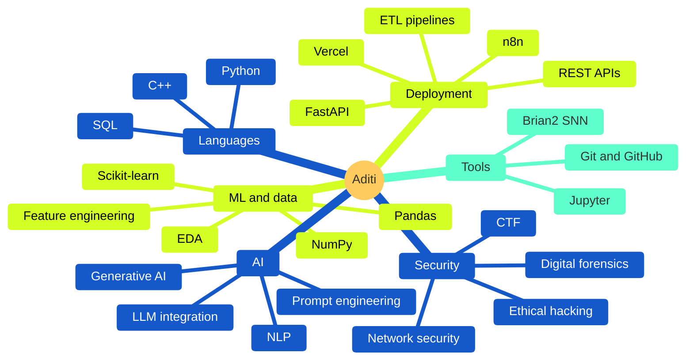
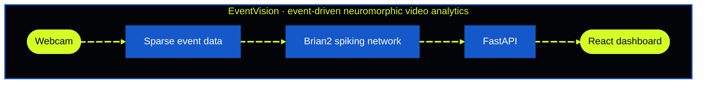
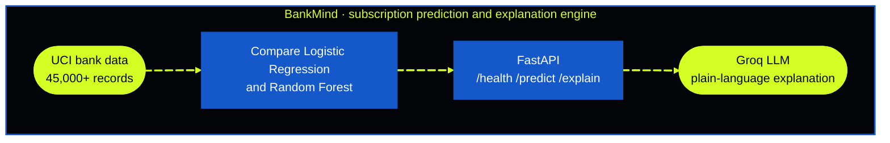
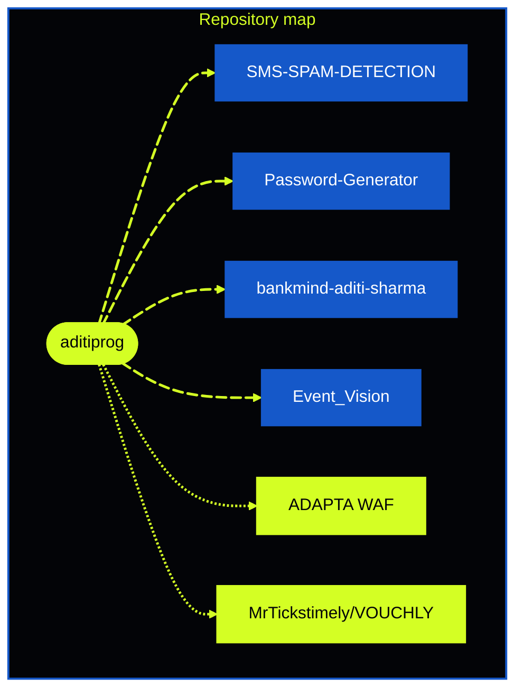

<p align="center"></p>

<p align="center"></p>

<p align="center"><a href="https://github.com/aditiprog"></a></p>

<p align="center">


</p>

```text
┏━━━━━━━━━━━━━━━━━━━━━━━━━━━━━━━━━━━━━━━━━━━━━━━━━━━━━━━━┓
┃  ⚡  W H O A M I                                       ┃
┗━━━━━━━━━━━━━━━━━━━━━━━━━━━━━━━━━━━━━━━━━━━━━━━━━━━━━━━━┛
```

```text
┌──(aditi㉿vitbhopal)-[~]
└─$ cat identity.json
{
  "name":     "Aditi Sharma",
  "degree":   "B.Tech CSE, Cyber Security & Digital Forensics",
  "campus":   "VIT Bhopal",
  "location": "Bhopal, India",
  "focus":    ["AI security", "machine learning", "NLP", "applied AI"],
  "built":    ["EventVision", "BankMind", "SMS Spam Detection", "Password Generator"],
  "team":     ["ADAPTA WAF", "VOUCHLY"],
  "award":    "Best Event-Driven Computing Prototype, NeuroNex"
}
```

```text
┏━━━━━━━━━━━━━━━━━━━━━━━━━━━━━━━━━━━━━━━━━━━━━━━━━━━━━━━━┓
┃  🔐  C Y B E R S E C U R I T Y  &  A I  F O C U S      ┃
┗━━━━━━━━━━━━━━━━━━━━━━━━━━━━━━━━━━━━━━━━━━━━━━━━━━━━━━━━┛
```

<p align="center">


</p>

```text
┏━━━━━━━━━━━━━━━━━━━━━━━━━━━━━━━━━━━━━━━━━━━━━━━━━━━━━━━━┓
┃  💻  S K I L L S                                       ┃
┗━━━━━━━━━━━━━━━━━━━━━━━━━━━━━━━━━━━━━━━━━━━━━━━━━━━━━━━━┛
```

<p align="center">
<sub><b>LANGUAGES</b></sub><br>


<br><br>
<sub><b>MACHINE LEARNING &amp; DATA</b></sub><br>


<br><br>
<sub><b>AI &amp; GENERATIVE AI</b></sub><br>


<br><br>
<sub><b>DEPLOYMENT &amp; AUTOMATION</b></sub><br>


<br><br>
<sub><b>SECURITY FOUNDATIONS</b></sub><br>


<br><br>
<sub><b>TOOLS &amp; PLATFORMS</b></sub><br>


</p>



```text
┏━━━━━━━━━━━━━━━━━━━━━━━━━━━━━━━━━━━━━━━━━━━━━━━━━━━━━━━━┓
┃  🚀  F E A T U R E D  P R O J E C T S                  ┃
┗━━━━━━━━━━━━━━━━━━━━━━━━━━━━━━━━━━━━━━━━━━━━━━━━━━━━━━━━┛
```

**EventVision** — turns camera frames into sparse event data, scores activity with a spiking neural network and shows it live on a dashboard. 🏆 Best Event-Driven Computing Prototype at NeuroNex.  
[Repository](https://github.com/aditiprog/Event_Vision) · [Live dashboard](https://frontend-7obzm9ald-aditi-s-projects2521.vercel.app)



**BankMind** — predicts whether a bank customer will subscribe to a term deposit, then explains the result in plain language through an LLM.  
[Repository](https://github.com/aditiprog/bankmind-aditi-sharma)



```text
┏━━━━━━━━━━━━━━━━━━━━━━━━━━━━━━━━━━━━━━━━━━━━━━━━━━━━━━━━┓
┃  📊  G I T H U B  B A T T L E F I E L D                ┃
┗━━━━━━━━━━━━━━━━━━━━━━━━━━━━━━━━━━━━━━━━━━━━━━━━━━━━━━━━┛
```

<!--STATS:START-->
`55 contributions in 2026`  `4 public repositories`  `2 repos contributed to`
<!--STATS:END-->

<p align="center">


</p>

<p align="center"></p>

<p align="center"></p>

<!--CALENDAR:START-->
```text
2026 contribution calendar
     Jan  Feb Mar Apr May  Jun Jul Aug  Sep Oct  Nov Dec  
      ·······················█▓····················▓▓·····
Mon   ·············································▒······
      ············································▒·······
Wed   ····················································
     ·············▒······················▒················
Fri  ························▓···············▒··········· 
     ························▒··························· 

     Less · ░ ▒ ▓ █ More

Daily totals and monthly bars fill in on the first automatic update.
```
<!--CALENDAR:END-->

```text
┏━━━━━━━━━━━━━━━━━━━━━━━━━━━━━━━━━━━━━━━━━━━━━━━━━━━━━━━━┓
┃  📁  R E P O S I T O R I E S                           ┃
┗━━━━━━━━━━━━━━━━━━━━━━━━━━━━━━━━━━━━━━━━━━━━━━━━━━━━━━━━┛
```

Every public repository I author. This section rebuilds itself automatically, so new repos appear without editing this file.

<!--MAP:START-->

<!--MAP:END-->

<!--REPOS:START-->
| Repository | About | Language | ★ |
|:--|:--|:--|--:|
| **[SMS-SPAM-DETECTION](https://github.com/aditiprog/SMS-SPAM-DETECTION)** | SMS spam detection. |  |  |
| **[Password-Generator](https://github.com/aditiprog/Password-Generator)** | Password generator. |  |  |
| **[bankmind-aditi-sharma](https://github.com/aditiprog/bankmind-aditi-sharma)** | Term-deposit prediction API with an LLM explanation layer. | `Python` |  |
| **[Event_Vision](https://github.com/aditiprog/Event_Vision)** | Event-driven neuromorphic video analytics. Python, FastAPI, React. Live on Vercel. | `Python` |  |
<!--REPOS:END-->

```text
┏━━━━━━━━━━━━━━━━━━━━━━━━━━━━━━━━━━━━━━━━━━━━━━━━━━━━━━━━┓
┃  🤝  T E A M  P R O J E C T S  &  C O N T R I B U T I O N S┃
┗━━━━━━━━━━━━━━━━━━━━━━━━━━━━━━━━━━━━━━━━━━━━━━━━━━━━━━━━┛
```

Projects I work on with a team or contribute to on other accounts. Public ones are picked up automatically; private ones are listed from `profile-extras.json`.

<!--CONTRIBS:START-->
| Project | About | Commits | PRs |
|:--|:--|--:|--:|
| **[MrTickstimely/VOUCHLY](https://github.com/MrTickstimely/VOUCHLY)** | Team project. | 5 |  |
| **[ADAPTA WAF](https://github.com/Sinflin/WAF)** <sub>Sinflin/WAF</sub> `private` | Web application firewall. Team project (private repository). |  |  |
<!--CONTRIBS:END-->

```text
┏━━━━━━━━━━━━━━━━━━━━━━━━━━━━━━━━━━━━━━━━━━━━━━━━━━━━━━━━┓
┃  📬  L E T ' S  C O N N E C T                          ┃
┗━━━━━━━━━━━━━━━━━━━━━━━━━━━━━━━━━━━━━━━━━━━━━━━━━━━━━━━━┛
```

<p align="center">
<a href="mailto:aditi.stack@gmail.com"></a>
<a href="https://www.linkedin.com/in/aditi-sharma-developer"></a>
<a href="https://github.com/aditiprog"></a>
<a href="https://github.com/aditiprog/aditiprog/raw/main/Aditi_Sharma_Resume.pdf"></a>
</p>

<p align="center"></p>

